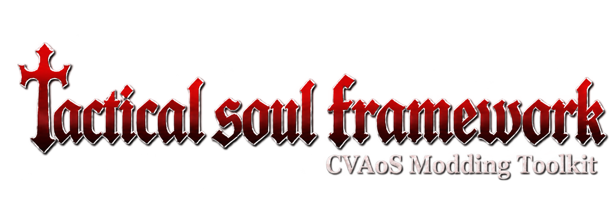

# Tactical Soul Framework



**Status: v0.54.0-foundation - about36% complete (35.8/100 on the tracked roadmap).**
Original boot melodies support checked notes/repeats and confined mono8 WAV
instruments, with native waveform, pitch, silence, exhaustion and selected
menu/new-game/pause-resume evidence;
484 tests pass. Melodies support four simultaneous tracks sharing eight original
WAV instruments, with authored attack/decay/sustain/release settings, rests and
shorter gates. Native controls cover selected envelope and isolated/mixed windows.
Selected multitrack scene takeover passes; the Start-button sound probe is
unresolved. Tear-style soul abilities with gameplay SFX remain unfinished; a
bounded Winged Skeleton cast trace names two cast-correlated actors (soul code
at slot 2, companion at slot 3, frames +7..+61, twin-identical) with no
render/damage/SFX proof yet; record words 16/17 grow in both slots and are the
prime position candidates: all monotonic over 27 samples at similar cross-slot
rates, steady but not constant, scale unproven. The cast rewrites OAM entries
0–8 and replaces OBJ palette 2 against a zero-change idle control, with stale
state persisting after despawn. A zombie-room hit attempt shows unreliable
casting (two 0-MP fizzles before one live cast, cause open) and a +1 EXP kill
of an unidentified victim — a sword-kill control now matches the +1 EXP payout
and places the burst codes in the zombie kill-remnant class, giving first
kill-level projectile attribution without per-hit HP proof. A follow-up HP hunt
found the per-hit confirm flag (slot 29 word 4) but not the HP word itself. The
cast's tile set is now concrete (tiles 146/150/272/400/668, the 912–943 region
and OBJ palette 2) for a future reskin. First casts fizzle (0 MP) regardless of range — the gate is count-based
(2 early fizzles, then late fizzle-then-fire), so bindings must budget ~3
presses per real cast; hold-length variants (1/5/15 frames) all fizzle, so the
gate counts presses, not held input. Equal-length audio windows show a
cast-attributed difference (1.75x peak / 1.7x RMS over a flat idle control)
in mixed BGM+SFX output — no isolated SFX yet. First decompiler evidence
pins the soul actor (`FUN_08026008`: spawn/fly/burst/cleanup states), its
companion follower, the position/velocity record map (words 9/10 and 16/17),
and the spawn sound (`0xe4` through global dispatcher `FUN_080d7910`, 652
callers); zombie per-hit damage pinned at 22 single-frame (n=2; supersedes clamped 18→0) with `total_damage`/`casts_to_kill` helpers, while the damage formula damage = (45−DEF)//2 holds on three DEFs (1→22, 10→17, 5→20; soul follows facing but the skeleton still escapes — velocity/mailbox check next; descriptor 27 out as raw damage) and write permission stays open.
See [soul decompilation](docs/SOUL-DECOMPILE.md). A slot-2 HP track came back negative (slash flashes only)
— victim identity must come from the attributed code set, not guessed slots. The
attributed holder (slot 30) carries no HP at word or halfword granularity —
but behaviorally one live soul cast kills the zombie where the sword needs
8–31 rolls.
See [soul projectile trace](docs/SOUL-PROJECTILE-TRACE.md).
Project modules retain single ownership and fingerprints.
Soul-cost, room/art and ability examples remain available.
Broad audio lifecycle, generic soul grants and total conversions remain unfinished.
See [WAV instruments](docs/MUSIC-SAMPLES.md) and [boot melodies](docs/BOOT-MELODY.md).
This is a working modding foundation for Castlevania: Aria of Sorrow (GBA, USA
revision 0), not a finished editor. The goal is broad modding support; what's here
now is a solid core of records, checked patches, allocation, room/entity/door
structures, a verified per-frame hook, and build/inspect/launch tooling backed by
real emulator tests. A visual level editor and a full campaign/save compiler are
still ahead.

## What you can build today

- **Original WAV instrument** - import a checked mono8 sample for a boot melody (`examples/imported-melody`).

- **Original boot melodies** � author checked notes and finite repeats with original sine PCM (`examples/boot-melody`, `examples/boot-melody-loop`).

- **Soul cost tuning** � checked Winged Skeleton MP cost with unchanged native acquisition (`examples/soul-cost`).

- **Balance and economy remixes** — retune weapons, enemy stats and EXP, and
  item drops through named records with guard rails (`examples/enemy-workshop`,
  `examples/equipment-workshop`).
- **Small ability tweaks** — stationary HP regen plus an R-button heal with MP
  cost and cooldown (`examples/ability-workshop`).
- **Room experiments** — move enemies within a room, reconnect existing doors,
  repaint terrain in registered rooms, import original tiles and palettes
  (`examples/room-workshop`, `examples/geometry-workshop`,
  `examples/original-room-art`, `examples/bridge-route`, `examples/bridge-art`,
  `examples/three-room-art`).
- **Flesh sanctuary** — start in a flesh-themed save room, exit right into a
  zombie corridor, with red statue/save particles/zombies
  ([custom_room](examples/custom_room/README.md)).
- **Cosmetic sprite swap** — replace the shared bats/clouds art with your own
  indexed pixels (`examples/sky-invaders`).
- **Original item icons** — draw new icons on registered pages
  (`examples/named-content-workshop`).
- **Custom names** — rename items and enemies within their original byte
  length, proven to render in menus (`examples/label-workshop`).

[MODS-YOU-CAN-MAKE-NOW.md](docs/MODS-YOU-CAN-MAKE-NOW.md) sketches five of these
ideas with their scope and limits. Every build writes a separate ROM; your
original file is never touched.

## What's to come

The roadmap aims at full total conversions: a campaign, map and save compiler
so custom rooms link into a playable game; new rooms from scratch with complete
collision families; real sprite-animation pipelines with a VRAM allocator;
audible custom music and sound effects bound to the native driver; item, soul
and EXP grant APIs with persistent custom mechanics; enemy AI and
event-safe boss authoring; and a graphical room viewer/editor built on the
headless document backend. Each piece lands as a tested, documented slice —
`framework/roadmap.json` tracks the weighted progress.

## What you need to provide yourself

A few files can't ship with the project, so bring your own:

| File | Where it goes | Why |
|---|---|---|
| `CastlevaniaAoS.gba` | Framework root (next to `TacticalSoul.cmd`) | Your own dump of Aria of Sorrow, USA revision 0: 8,388,608 bytes, SHA-256 `910f88d3…36430a5`. Every build checks the hash and refuses anything else. Never shared, never committed. |
| `tools/libretro/mgba_libretro.dll` | `tools/libretro/` | The mGBA libretro core. Only needed for the native verification scripts; normal builds and play don't touch it. |
| `tools/zig/` (Zig 0.15.2) | `tools/zig/` | Only needed with `--compile` for custom native code. The stock examples ship prebuilt binaries and compile nothing. |
| Python 3.14 with Pillow | Anywhere on PATH | Only needed for the verification scripts. Normal builds and launching use the bundled runtime below. |
| `runtime/python/` and `runtime/emulator/` | Extract from the latest `release/*.zip` | Bundled Python and the mGBA player. They live in git, so grab them from the newest release archive in `release/`. |

Current custom-content entry points: [RESOURCE-AUTHORING.md](docs/RESOURCE-AUTHORING.md) and [TOTAL-CONVERSIONS.md](docs/TOTAL-CONVERSIONS.md). The first is implemented authoring; the second is the staged plan for remaining conversion systems.

## Quick start (Windows x64)

From this folder in PowerShell:

```powershell
.\TacticalSoul.cmd enemies --enemy zombie
.\TacticalSoul.cmd play examples/enemy-workshop/mod.json
.\TacticalSoul.cmd equipment --table weapons --item knife
.\TacticalSoul.cmd play examples/equipment-workshop/mod.json
.\TacticalSoul.cmd inspect --table enemies --index 0
.\TacticalSoul.cmd inspect --room 0 0
.\TacticalSoul.cmd build examples/native-balance/mod.json
.\TacticalSoul.cmd play examples/native-balance/mod.json
.\TacticalSoul.cmd play examples/frame-counter/mod.json
```

The bundled Python and mGBA are found automatically. Outputs go to
build/mods/<id>/<id>.gba with a mutation manifest alongside. Original ROMs are
never overwritten. If your original is elsewhere, use --host "C:\path\game.gba"
or set ARIA_HOST_ROM. Exact SHA-256 and size are required. The private development
copy already includes the user's exact Aria original; it must never be distributed.

For C edits in frame-counter:

```powershell
.\TacticalSoul.cmd play examples/frame-counter/mod.json --compile
```

Zig 0.15.2 is copied into tools/zig. Source/linker/bin hashes prevent silent reuse
of stale callback code. Embedded player builds need no compiler. The simple
fingerprint tracks explicitly declared dependencies. Add every included header to build.json dependencies; transitive includes are not discovered automatically.

## Where to start reading

- AGENTS.md and docs/START-HERE.md: scope, working baseline, boundaries.
- docs/HOW-IT-WAS-BUILT.md: actual engineering history and corrected assumptions.
- docs/FILE-GUIDE.md: source files, dependencies and generated/private data.
- docs/NATIVE-INTEGRATION.md and docs/ROM-AND-RAM.md: hook/ABI/address knowledge.
- docs/DATA-CONTRACTS.md: native manifests versus Mario-specific data sheets.
- docs/EXTENDING.md and docs/FRAMEWORK-ROADMAP.md: full mods and future mashups.
- docs/TESTING.md and docs/KNOWN-LIMITS.md: tested behavior and missing systems.
- docs/TOOLS.md: toolchain versions, source references and reproducibility.

The Mario-specific portions of shared research references describe the separate
Aria of Mario World project. Their src/data/script paths are relative to that
project, not missing dependencies of Tactical Soul Framework. Tactical Soul Framework builds independently.

## Python API example

```python
from pathlib import Path
from aria.cli import load_image
from aria.tables import read_record, edit_record

original = Path("CastlevaniaAoS.gba")
rom = load_image(original)
print(read_record(rom, "enemies", 0))
edit_record(rom, "enemies", 0, {"hp": 18})
report = rom.output("build/my-mod.gba", original)
```

Raw patches require expected preimage bytes. Table edits rely on the verified
whole-original hash. Overlapping writes and allocation exhaustion fail. Native
entity arrays preserve identity and sorting; graphics and map/save changes need
separate implementation. Follow docs/EXTENDING.md for deeper modifications.

## Tests

```powershell
python -m unittest discover -s tests -v
python scripts/verify_framework.py
```

Synthetic tests need no game/runtime dependencies; native contract tests skip
without the private original. The emulator verifier needs the private Aria
copy, Pillow in the chosen Python, and the copied mGBA libretro DLL. It exercises
real GBA execution and reports limits. Player launching uses bundled Python;
test-time Pillow is a separate developer dependency. See docs/TESTING.md.

## Rights and packaging

Original integration code is MIT. Nintendo/Konami game content is excluded from
redistributable archives. Python, mGBA and toolchain licenses remain separate.
Do not zip this working folder: it contains private ROMs and generated games.
Use scripts/package_framework.py for an allowlist archive. No framework files
have been uploaded or published to an external service.


## Existing-room milestone (2026-10-10)

See [Room design guide](docs/ROOM-DESIGN.md) for sparse entity moves, paired existing doors, map/save diagnostics, commands, test evidence and extension guidance. `aria/level.py` implements this layer; `examples/room-workshop/mod.json` is its runnable example. General geometry/collision authoring, map relocation and campaign-wide graph repair remain unimplemented; the narrow terrain milestone below is available.

## Weapons and equipment

The [equipment guide](docs/EQUIPMENT.md) covers named catalog/search/export, signed stat bonuses, readable effect flags, precondition-checked edits and the playable equipment-workshop example. Run `python scripts/verify_equipment.py` for native stats, menu, combat and save checks.

## Enemy toolkit milestone (2026-10-10)

See [Enemy and encounter guide](docs/ENEMIES.md) for all 113 named records, expected-value balance edits, named item drops, readable flags and conservative same-room moves/clones. `examples/enemy-workshop/mod.json` is playable; `scripts/verify_enemies.py` checks native stats, EXP, a real item drop, encounter traversal and return. Arbitrary AI, species/resource provisioning, soul reassignment and boss/event placement remain extension work.

## Native ability SDK

Read [Ability SDK guide](docs/ABILITIES.md) for the registered dispatcher, JSON settings, input edges, conservative state guards, RAM claims, custom runtime copies and the extension workflow. Run `TacticalSoul.cmd play examples/ability-workshop/mod.json` for passive regeneration and an R-button heal with MP cost/cooldown. Single-feature examples are `examples/still-regen` and `examples/focus-heal`. Custom save schemas, native grants and input consumption remain extension work.

## Custom content foundation

Read [Custom content guide](docs/CUSTOM-CONTENT.md). `aria/content.py` imports indexed 4bpp tiles, RGB555 palettes and signed PCM, with checked replacement/allocation/pointer contracts. `examples/content-workshop/mod.json` replaces native item icons with original diamonds and composes healing abilities. Native icon rendering is verified. WAV samples are imported only; sound playback, music/voice linkage and arbitrary sprite animations remain unimplemented.

## Named resources and total-conversion direction

Read [RESOURCE-AUTHORING.md](docs/RESOURCE-AUTHORING.md) for named native icon pages/palettes, private exports, authored diffs, sparse edits, previews and important files. Use `TacticalSoul.cmd content-catalog`; runnable examples are `named-content-workshop` and `sparse-content-workshop`. Read [TOTAL-CONVERSIONS.md](docs/TOTAL-CONVERSIONS.md) for the staged engineering/acceptance plan. Full campaign geometry, general sprite animation and native audio playback remain unfinished. Native exports/diffs stay under local/ and must not enter source release examples.


## Room geometry foundation and project rename (2026-10-10)

The project is now **Tactical Soul Framework**, in its independent folder of the same name. Use `TacticalSoul.cmd`; `Dominance.cmd` and `Framework.cmd` remain aliases. See [rename compatibility](docs/RENAMING.md) for environment variables and retained native ABI identifiers.

Read [ROOM-GEOMETRY.md](docs/ROOM-GEOMETRY.md) before terrain work. `aria/compression.py` implements bounded LZ10/Aria resource reconstruction; `aria/geometry.py` inspects type-2 layers and applies checked, isolated existing-metatile edits. `inspect-geometry` and private `export-geometry` expose the source-backed format. `examples/geometry-workshop/mod.json` adds one stone step in the first hallway and composes the paired save-room route. Writes currently support only this registered main layer, unchanged dimensions and existing metatiles. New graphics, collision definitions, room resizing and full campaign compilation remain unimplemented.

Validation: 101 unit tests pass. `scripts/verify_geometry.py` passes eight structural/native checks: original walking reaches world X329, the edited step stops Soma at X311, native A jumping reaches X458, and fresh save/continue plus natural return stops at X360 on the other face. Initial comparisons declare a camera-relative X/zero-velocity fixture and retain settled Y; terrain is never injected into RAM. Private evidence stays in `local/geometry-verification.json`. See the geometry guide for format provenance, contracts, file responsibilities and next extensions.


## Static room previews and GUI editor goal

Read [ROOM-PREVIEWS.md](docs/ROOM-PREVIEWS.md) for the implemented renderer, private PNG/atlas/report command, resource formats, API contracts and native evidence. `TacticalSoul.cmd preview-room 0 3 --out local/previews/hallway.png` works with bundled Python. Add `--mod examples/geometry-workshop/mod.json` to preview checked terrain edits. `aria/rendering.py` returns GUI-independent RGBA buffers; it does not modify ROM data. The atlas currently includes referenced metatiles only. Native checks match all eight graphics chunks, eight palette banks and 7,217 opaque wall pixels for baseline and edited rooms. The suite now has 111 tests.

[GUI-EDITOR-ROADMAP.md](docs/GUI-EDITOR-ROADMAP.md) makes a graphical level editor an explicit goal and describes frontend/model boundaries, document/undo semantics, milestones and acceptance. No GUI, room catalog, layer compositor, complete brush catalog, inherited resources or 8bpp preview is implemented yet. Current source package: `release/Tactical-Soul-Framework-0.3.0.zip`. Update the inventory with `python scripts/update_inventory.py` before packaging. Native verification requires local development tools; normal previews do not.


## Room browser backend (v0.4)

[ROOM-CATALOG.md](docs/ROOM-CATALOG.md) documents `aria/room_catalog.py` and `TacticalSoul.cmd room-catalog`: stable base-state slot IDs, bounded pagination, independent diagnostics and optional rendering checks. The shared room lookup now handles the final sector using the source-backed area-table end boundary. Full private audit covers 343 slots; twelve selected layers render. 122 unit tests pass. Catalog availability describes decoder support, not gameplay safety; terrain permissions are unchanged. Current source package: `release/Tactical-Soul-Framework-0.4.0.zip`. Next editor foundation: immutable editor documents and undo/redo, followed by a viewer frontend.


## Custom terrain and tracked completion (v0.5)

Read [CUSTOM-TERRAIN.md](docs/CUSTOM-TERRAIN.md) for newly authored type-2 metatiles, explicit empty/solid collision, loaded-resource validation and isolated visual/collision streams. `examples/custom-terrain-workshop/mod.json` is runnable; `python scripts/verify_geometry.py --custom-terrain` verifies native pixels, walking, jumping, save/continue and return. All 127 unit tests pass. Original character/palette imports, VRAM allocation, other collision families and broader room writes remain unfinished.

[COMPLETION-ROADMAP.md](docs/COMPLETION-ROADMAP.md) and `framework/roadmap.json` track the total-conversion scope and weighted maturity estimate (currently about 21%). A GUI application is deferred; work goes into reusable framework APIs. Next: original room graphics/palette imports with isolated load lists and explicit resource budgets. Current package: `release/Tactical-Soul-Framework-0.5.0.zip`.


## Original room artwork (v0.6)

[ROOM-ASSETS.md](docs/ROOM-ASSETS.md) documents the registered original 4bpp/palette importer, isolated load lists, source/preimage guards, static VRAM/tilemap budgets and native evidence. `examples/original-room-art/mod.json` imports original neon-brick artwork and composes custom solid terrain with the save route. All 134 tests pass; native checks cover pixel identity, collision, jumping, fresh continue and exact resource reload on return. General VRAM ownership, other rooms, animation and death/pause/event coverage remain unfinished. Current package: `release/Tactical-Soul-Framework-0.6.0.zip`; tracked completion estimate is about 23%. Next: resource dependency/budget audits and broader native lifecycle support.


## Static dependencies and original-art lifecycle (v0.7)

[ROOM-RESOURCE-AUDIT.md](docs/ROOM-RESOURCE-AUDIT.md) documents `audit-resources`, static all-metatile dependencies, budgets, narrow shared-list consumer scanning and the 343-slot survey. Unloaded memory observations are not import authorization. `python scripts/verify_geometry.py --room-art --lifecycle` adds verified native B pause cancellation, forced-HP death/Game Over and fresh continue from post-death SRAM with exact art reload on natural return. All 141 tests pass. No new writable/import room registrations were added. Current package: `release/Tactical-Soul-Framework-0.7.0.zip`; estimated weighted completion is about 24%. Next: resolve unsupported/inherited resources and validate another ordinary room before expanding permissions.


## Mixed resource inspection (v0.8.0)

See [docs/MIXED-ROOM-RESOURCES.md](docs/MIXED-ROOM-RESOURCES.md) for raw/LZ 4bpp and 8bpp load inspection, format guards, public API contracts and remaining limitations. Full suite: 145 tests. Static survey: 343 slots, 6 rooms with load diagnostics. No additional write targets or 8bpp terrain rendering.


## Byte-index background inspection (v0.9.0)

See [docs/BYTE-INDEX-BACKGROUNDS.md](docs/BYTE-INDEX-BACKGROUNDS.md) for the separate read-only type-1/type-3 API and private lossless exports. All 24 native byte-index layers roundtrip; 149 tests pass. Rendering, collision semantics and write permissions remain pending. Existing type-2 consumers retain their contracts.


## Static background source rendering (v0.10.0)

See [docs/BACKGROUND-RENDERING.md](docs/BACKGROUND-RENDERING.md) for preview-background, 8bpp source APIs and native memory evidence. 153 tests; native character loads, declared palettes and a 1024-byte type-3 tilemap verified. Native viewport pixel matching remains unresolved; no new write permissions.


## Integrated background discovery (v0.11.0)

See [BACKGROUND-DISCOVERY.md](docs/BACKGROUND-DISCOVERY.md) for catalog/audit schema version 2, format-aware dispatch and texel-derived palette dependencies. 156 tests; 925 nonempty layers inspect and all 24 byte-index source rasters render. No new write permissions or viewport verification. See [MODS-YOU-CAN-MAKE-NOW.md](docs/MODS-YOU-CAN-MAKE-NOW.md) for current playable-mod examples.


## Tilemap accounting and multiplayer feasibility (v0.12.0)

See [TILEMAP-MEMORY.md](docs/TILEMAP-MEMORY.md) for corrected text/affine byte ranges and partial-chunk reservations, with 157 tests and native fixture evidence. No new write slots. See [MULTIPLAYER-FEASIBILITY.md](docs/MULTIPLAYER-FEASIBILITY.md) for optional multiplayer research directions; no multiplayer feature is implemented.


## Bounded room-state discovery (v0.13.0)

See [ROOM-STATES.md](docs/ROOM-STATES.md) for room-states, chain bounds/diagnostics and explicit empty-load observations. 161 tests. All 343 original base slots have zero alternate links; alternate chain behavior is synthetically tested, not natively certified. No new editing or multiplayer capability.


## Two-room original art (v0.14.0)

See [TWO-ROOM-ART.md](docs/TWO-ROOM-ART.md) for hallway plus save-room registered main layers, contrasting original graphics/palettes, native entry/return/save/death/fresh-continue evidence and limits. Run examples/two-room-art/mod.json. Full suite: 163 tests. Current estimate: 25%. No arbitrary-room or multiplayer permission.


## Three-room original-art route (v0.15.0)

See [THREE-ROOM-ART.md](docs/THREE-ROOM-ART.md) for registered room 0,6 plus hallway/save targets, native contrasting-resource route and lifecycle checks, effect-aware fixed-rectangle capture and campaign limits. Run examples/three-room-art/mod.json. 164 tests; current estimate 26%. No arbitrary-room registration or repaired full campaign graph.


## Static world graph (v0.16.0)

See [WORLD-GRAPH.md](docs/WORLD-GRAPH.md) for world-graph, incoming/outgoing edges, observed direct returns and mod routing deltas. Three-room example: four displaced incoming links explicitly identified. 170 tests; no automatic repairs, progression certification or new room permissions. Current estimate: 26%.


## v0.17 connection proposals

See [Connection planning](docs/CONNECTION-PLANNING.md) for the isolated existing-door planner, input/output contracts, four restored static return links, and required native landing verification. `plan-connections` emits review evidence only. Current completion remains 26%; 174 tests pass with the private supported host.


## v0.18 native endpoint evidence

[Native connection testing](docs/NATIVE-CONNECTION-TESTING.md) documents four controlled bidirectional crossings, settled landings and movement checks. Independent endpoint position fixtures are explicit; continuous room5 traversal and repaired-campaign lifecycle remain pending. The planner remains static-only; existing playable examples are unchanged.


## v0.19 input replay foundation

[Input replay and checkpoints](docs/INPUT-REPLAYS.md) documents bounded JSON input traces, boundary assertions, same-instance native forks and a 28-candidate room5 jump sweep. No candidate reached the continuous-route goal; this is not an impossibility proof. 180 unit tests pass. The original route examples and endpoint proof remain unchanged.


## v0.20 terrain authoring milestone

[Rectangle terrain authoring](docs/TERRAIN-PAINTING.md) adds `plan-terrain`, checked room5 support and the separate bridge-route example. Input-only full bridge crossings pass in both directions; the final build separately passes main-route save/death/fresh-continue and art regression. 184 tests pass. Estimated framework completion is now 27%; prior milestone percentages are historical.


## v0.21 terrain discovery and living handoff

[Terrain support discovery](docs/TERRAIN-SUPPORT.md) adds paginated main-layer diagnostics and loaded brush IDs. The original 343-slot survey finds 4 registered, 311 static candidates and 28 blocked rooms; candidates are not write grants. Ongoing work is tracked in [handoff notes](handoff.md), refreshed with `scripts/update_handoff.py` ahead of each inventory/package refresh.


## v0.22 project composition

[Source project composition](docs/PROJECT-COMPOSITION.md) adds ordered terrain/route/art/data modules, early ownership errors, asset fingerprints, transactional project staging and `plan-project`. Build/play accept project JSON directly. The modular bridge example reproduces the flat build exactly; existing single-file manifests remain supported. 202 tests pass with the private host. Current maturity estimate: 29% (28.6/100).


## v0.23 sprite structure backend

See [Sprite inspection](docs/SPRITES.md) for `aria/sprites.py`, registered common/Julius/background-bats resources, bounded frames/parts/hitboxes/animations, and lossless fixed-record checks. Run `TacticalSoul.cmd inspect-sprite common`. 209 tests pass with the private host. This is read-only: actor rendering/replacement and real Soma animation binding remain unfinished. Next: registered page/palette resolution and static sprite previews, then native original-art replacement. Completion remains 29%; this prerequisite does not complete sprite authoring.


## v0.24 static sprite previews

[Sprite guide](docs/SPRITES.md) documents `aria/sprite_rendering.py`, explicit page/palette registrations, packed 8x8 source addressing, transparent RGBA composition, source bank selection, bounds and origin contracts. `TacticalSoul.cmd preview-sprite julius --frame 0 --out local/sprite-previews/julius-0.png` works with bundled Python. `scripts/verify_sprites.py` covers all 216 registered frames and creates private contact sheets; source releases exclude those images. 222 tests pass. Static previews do not prove native OAM/resource ownership or permit sprite writes. Next: verified native consumer binding and one checked original-art replacement. Completion: 29% (29.1/100).


## v0.25 original native sprite artwork

[Sprite authoring](docs/SPRITE-AUTHORING.md) documents `aria/sprite_assets.py`, the fixed shared bats/clouds page/palette, guarded compressed relocation, transaction/source protection, original `examples/sky-invaders` content and native evidence. Run `TacticalSoul.cmd play examples/sky-invaders/mod.json`; `preview-sprite` and `inspect-sprite` now accept `--mod`. `scripts/verify_sprite_assets.py --lifecycle` verifies final-example native entry/pause/reentry and a separate composed save/death/fresh-continue harness. 234 tests pass. Completion: 30% (30.0/100). Next: one ordinary enemy visual binding and combat lifecycle, plus checked project-module sprite composition. Read [REA workflow](docs/REA-WORKFLOW.md): user requires the skill and connected MCP for binary investigation; skill installed locally, MCP not registered/exposed here.
